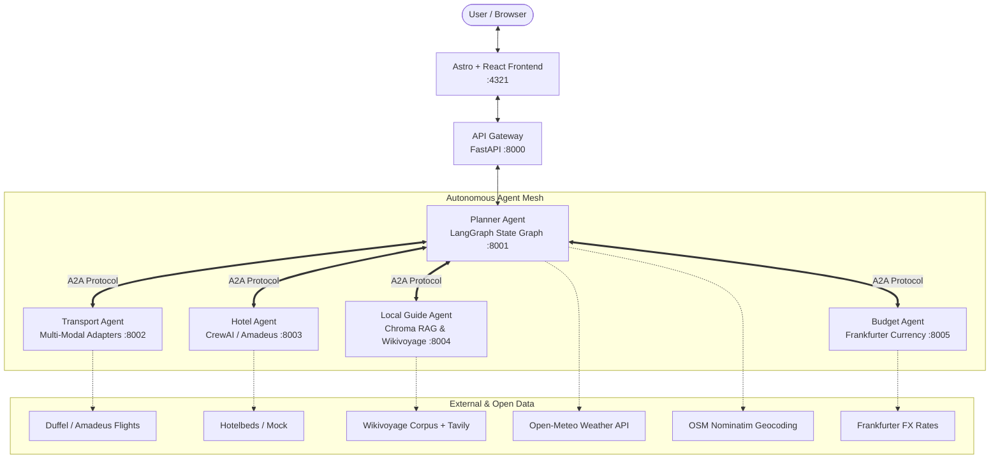

# TripMesh 🌐✈️

> **Multi-Agent AI Travel Concierge** built with LangGraph, A2A Protocol, CrewAI, RAG with Chroma, and an Astro + React frontend.

[](https://github.com/Infernapx/tripmesh/actions/workflows/ci.yml)
[](https://codespaces.new/Infernapx/tripmesh)
[](https://opensource.org/licenses/MIT)

TripMesh transforms chaotic travel planning into an intelligent conversation. Instead of juggling dozens of browser tabs for flights, hotels, weather, local attractions, and budgets, TripMesh deploys a coordinated mesh of specialized autonomous agents that collaborate, negotiate, and adapt to your constraints in real time.

---

## 🏛️ System Architecture

TripMesh implements a decentralized **Agent-to-Agent (A2A)** architecture governed by a central **LangGraph Orchestrator**:



---

## ✨ Key Features

- **Multi-Agent Orchestration**: Specialized microservices communicate over standard HTTP A2A JSON contracts.
- **Dynamic Replanning (LangGraph)**: Seamlessly update dates, switch to cheaper hotels, report flight delays, or adjust budget caps without restarting the conversation.
- **Automated Weather Tip Line**: Deterministic one-line weather guidance directly inside the plan card (`"Hot in Mumbai (28-36°C), pack light cotton and sunscreen."`).
- **Interactive Calendar Range Picker**: Accessible modal date-range selector with real-time nights calculation and client/server date validation.
- **Context-Aware Budget Banner**: Budget status and negotiation blocks only appear when requested by the user, staying clean and unobtrusive.
- **RAG-Grounded Local Guide**: Activity recommendations sourced directly from Wikivoyage guides stored in an embedded Chroma vector store.
- **Honest Data Quality**: All mock or simulated data is explicitly tagged with `[Estimated]` reference labels—no fabricated flight numbers or hidden assumptions.
- **Multi-Modal Export**: One-click download of PDF itineraries and `.ics` calendar sync files.

---

## 🛠️ Technology Stack

| Layer | Technologies |
| :--- | :--- |
| **Frontend** | Astro 5, React 19, Tailwind CSS, Lucide Icons, Glassmorphic UI |
| **Agent Orchestration** | LangGraph, LangChain Core, CrewAI |
| **APIs & Microservices** | FastAPI, Uvicorn, HTTPX Async Client, Pydantic v2 |
| **Vector DB & Search** | ChromaDB, Sentence-Transformers, Tavily Search API |
| **External APIs** | Open-Meteo (Weather), Frankfurter (FX), OSM Nominatim (Geocoding), OurAirports (Airports CSV) |
| **DevOps & CI** | Docker, Docker Compose, GitHub Actions, Dev Containers |

---

## 🚀 Quick Start

### Option A: Run via Docker Compose (Recommended)

Start the entire agent mesh and frontend with a single command:

```bash
# Clone the repository
git clone https://github.com/Infernapx/tripmesh.git
cd tripmesh

# Copy sample environment configuration (all keys are optional!)
cp .env.example .env

# Build and start all 7 microservices
docker compose up --build
```

- **Frontend UI**: [http://localhost:4321](http://localhost:4321)
- **API Gateway**: [http://localhost:8000](http://localhost:8000)
- **Interactive API Docs**: [http://localhost:8000/docs](http://localhost:8000/docs)

---

### Option B: Local Python Development

#### Prerequisites
- Python 3.11+
- Node.js 20+

```bash
# 1. Create and activate a virtual environment
python -m venv .venv
source .venv/bin/activate  # On Windows: .venv\Scripts\activate

# 2. Install dependencies
pip install -r requirements.txt
cd frontend && npm install && cd ..

# 3. Start the entire mesh and frontend
python run_mesh.py
```

---

## ⚙️ Environment Variables

All variables are **optional**. If no API keys are provided, TripMesh automatically falls back to deterministic mock adapters and estimated offline data:

| Variable | Description | Default / Fallback |
| :--- | :--- | :--- |
| `GEMINI_API_KEY` | Google Gemini API key for natural language reasoning | Local semantic rule engine |
| `DUFFEL_ACCESS_TOKEN` | Duffel Flights API sandbox/live token | Simulated mock flights `[Estimated]` |
| `AMADEUS_API_KEY` | Amadeus travel API key | Mock transport adapter |
| `HOTELBEDS_API_KEY` | Hotelbeds APItude credentials | Mock hotel adapter `[Estimated]` |
| `TAVILY_API_KEY` | Real-time web search for news and road advisories | Graceful degradation with honest notice |
| `CHROMA_PERSIST_DIR` | Directory for vector store persistence | `./local_guide_agent_rag/data/chroma_db` |
| `TRIPMESH_DB_PATH` | Path for SQLite memory and session database | `./shared/data/tripmesh_memory.db` |
| `LOG_LEVEL` | Logging verbosity (`DEBUG`, `INFO`, `WARNING`) | `INFO` |

---

## 💬 Example Prompts to Try

TripMesh supports natural conversational travel planning. Try these in the UI:

1. **New Journey**:
   - `"Plan a trip from Delhi to Mumbai"`
   - `"Fly from London to Lisbon next month"`
2. **Refinements**:
   - `"Can we find a cheaper hotel?"`
   - `"Change dates to 15 Nov - 20 Nov"`
3. **Budget Constraints**:
   - `"My total budget is 35000 INR"`
   - `"Is this within my budget target?"`
   - `"Remove budget"`
4. **Destination Intelligence**:
   - `"What's the weather like in Mumbai in November?"`
   - `"Are there any road closures or travel advisories?"`
   - `"Tell me what to see and eat in Lisbon"`

---

## 📁 Repository Structure

```
tripmesh/
├── docker-compose.yml        # Orchestrates all microservices
├── Makefile                  # Developer shortcuts (setup, dev, test, build)
├── run_mesh.py               # Lightweight local multi-process mesh runner
├── requirements.txt          # Unified Python dependencies
├── .env.example              # Documented environment variable template
├── shared/                   # Pydantic schemas, geocoding, weather & memory store
├── gateway/                  # FastAPI gateway proxying frontend to mesh
├── planner_agent/            # LangGraph coordinator & intent classification
├── transport_agent/          # Multi-modal transport search (air, rail, bus)
├── hotel_agent_crewai/       # Hotel accommodation agent (CrewAI + Amadeus)
├── local_guide_agent_rag/    # RAG guide grounded on Wikivoyage & ChromaDB
├── budget_agent/             # Frankfurter currency conversion & reconciliation
├── frontend/                 # Astro 5 + React glassmorphic web application
├── docs/                     # Architecture, PRD, and design specifications
└── tests/                    # End-to-end integration and unit test suite
```

---

## 🧪 Testing & Verification

Run the automated test suite across all agents:

```bash
# Run all unit and integration tests
pytest tests/ -v

# Run Python compilation check
python -m compileall shared planner_agent gateway transport_agent hotel_agent_crewai local_guide_agent_rag budget_agent

# Build frontend static bundle
cd frontend && npm run build
```

---

## ⚖️ Data Attributions & Open Licenses

TripMesh proudly builds upon open data and free developer services:
- **Wikivoyage**: Destination guides and travel advice licensed under [CC BY-SA 4.0](https://creativecommons.org/licenses/by-sa/4.0/).
- **Open-Meteo**: Weather forecast data under [CC BY 4.0](https://open-meteo.com/).
- **OpenStreetMap / Nominatim**: Geocoding and reverse lookup © OpenStreetMap contributors under [ODbL](https://www.openstreetmap.org/copyright).
- **OurAirports**: Global airport database and IATA code dataset under Public Domain.
- **Frankfurter**: Real-time European Central Bank foreign exchange rates.

---

## 📄 License

This project is licensed under the **MIT License**. See the [LICENSE](LICENSE) file for details.
